# 实验记录（Experiments）

本文档记录本项目在 TinyStories 数据集上的训练实验与消融实验，重点分析不同训练超参数、Normalization、Positional Encoding、FFN 结构以及 Gradient Clipping 对模型收敛速度、训练稳定性和最终性能的影响。

## 实验设置

Baseline 模型采用 Pre-Norm Transformer 架构，主要组件包括 RMSNorm、RoPE、Multi-Head Self-Attention 和 SwiGLU FFN。

### 模型配置

| Configuration | Value |
|---|---:|
| Vocabulary Size | 10,000 |
| Context Length | 256 |
| d_model | 512 |
| Number of Layers | 4 |
| Number of Attention Heads | 16 |
| d_ff | 1344 |
| Non-Embedding Parameters | ~17M |

### 训练配置

| Configuration | Value |
|---|---:|
| Dataset | TinyStories |
| Batch Size | 24 |
| Training Steps | 6500 |
| Training Tokens | ~40M |
| Optimizer | AdamW |
| Gradient Clipping | Enabled |
| Hardware | NVIDIA RTX 2060 / L4 |

除特别说明外，各组消融实验均尽量保持其他训练配置一致，仅修改目标变量。

## 1. Learning Rate Sweep

### 实验目的

Learning Rate 是影响模型收敛速度和训练稳定性的关键超参数。本实验在保持模型结构、Batch Size、训练步数等配置不变的情况下，对不同 Learning Rate 进行对比，观察其对训练收敛速度、最终 loss 以及训练稳定性的影响，并为后续消融实验选择合适的 baseline Learning Rate。

### 实验设置

所有实验均采用相同的模型结构和训练配置，每组训练 **6500 steps**，对应约 **39.9M tokens**。测试以下 Learning Rate：

```text
1e-4, 3e-4, 5e-4, 7e-4, 1e-3, 1.5e-3, 3e-3
```

为了避免仅根据单个 step 的 loss 判断模型性能，实验同时比较以下指标：

| Metric | Description |
|---|---|
| `last_1000_mean` | 最后 1000 steps 的平均 training loss，用于衡量最终收敛水平 |
| `last_1000_std` | 最后 1000 steps loss 的标准差，用于衡量后期训练稳定性 |
| `last_500_mean` | 最后 500 steps 的平均 training loss |
| `min_loss` | 整个训练过程中达到的最低 training loss |
| `step_to_1.8` | training loss 首次降至 1.8 以下所需的 step |
| `step_to_2.0` | training loss 首次降至 2.0 以下所需的 step |

### 实验结果

| Learning Rate | `last_1000_mean` ↓ | `last_1000_std` ↓ | `last_500_mean` ↓ | `min_loss` ↓ | `step_to_1.8` ↓ | `step_to_2.0` ↓ |
|---|---:|---:|---:|---:|---:|---:|
| `1e-4` | 1.98575 | 0.08483 | 1.97064 | 1.80926 | 未达到 | 4080 |
| `3e-4` | 1.76173 | 0.07432 | 1.75197 | 1.59810 | 3200 | 2080 |
| `5e-4` | 1.73707 | 0.08276 | 1.71186 | 1.56707 | 2440 | 1520 |
| `7e-4` | 1.72016 | 0.06959 | 1.69910 | 1.54736 | **2420** | **1140** |
| **`1e-3`** | **1.69992** | **0.06668** | **1.69742** | **1.54023** | 2820 | 1400 |
| `1.5e-3` | 1.73212 | 0.07070 | 1.71957 | 1.59470 | 3540 | 1600 |
| `3e-3` | 2.57150 | 0.07701 | 2.56087 | 2.41778 | 未达到 | 未达到 |

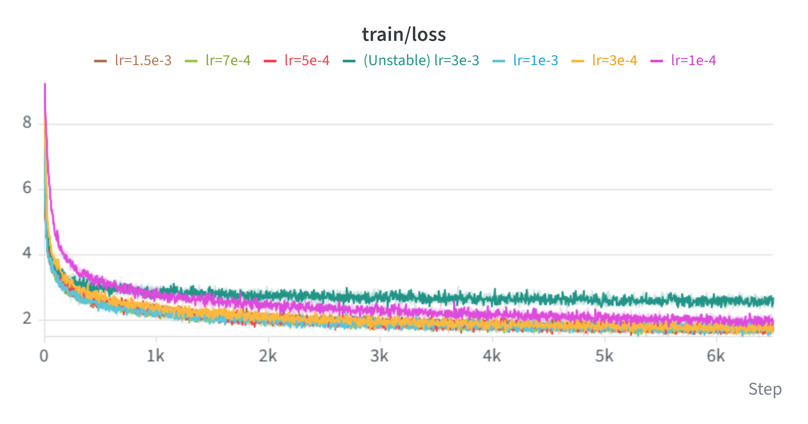
*Figure 1. 不同 Learning Rate下的 training loss 曲线*

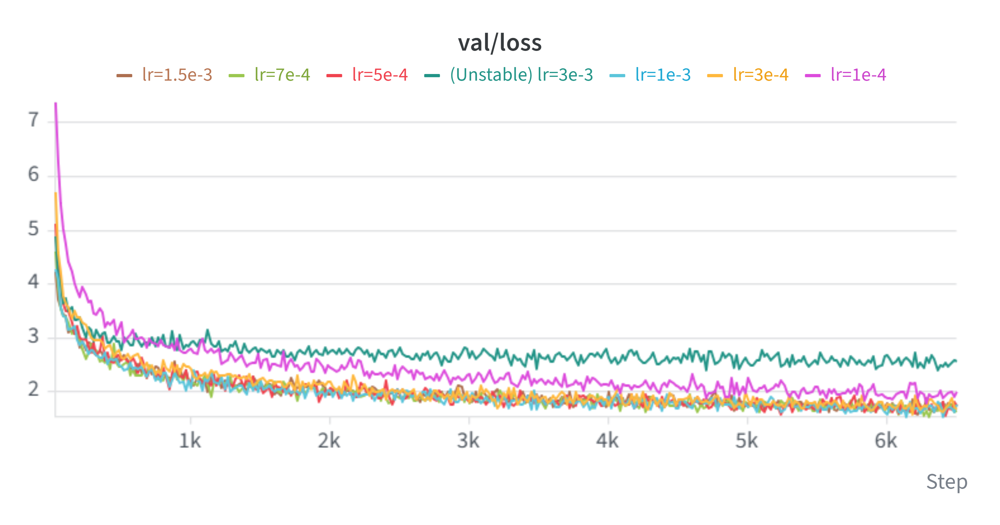
*Figure 2. 不同 Learning Rate下的 validation loss 曲线*


### 结果分析

实验结果表现出较清晰的 Learning Rate 最佳区间。

当 Learning Rate 较小时，模型训练稳定，但在固定 training budget 下收敛较慢。`1e-4` 在 6500 steps 后的 `last_1000_mean` 仍为 **1.98575**，且整个训练过程中都未达到 loss 1.8，说明该 Learning Rate 在当前训练步数下明显不足以充分优化模型。

随着 Learning Rate 从 `1e-4` 增大到 `7e-4`，模型的收敛速度显著提高。`7e-4` 最快达到 loss 2.0 和 1.8，分别仅需要 **1140** 和 **2420 steps**，是所有实验中早期收敛速度最快的配置。

继续增大到 `1e-3` 后，模型早期达到固定 loss threshold 的速度略慢于 `7e-4`，但取得了最好的最终收敛结果：`last_1000_mean = 1.69992`、`last_500_mean = 1.69742`、`min_loss = 1.54023` 均为所有配置中的最优结果。同时其 `last_1000_std = 0.06668` 也是最低值，表明 `1e-3` 在当前实验中兼具较好的最终性能与后期训练稳定性。

当 Learning Rate 继续增大到 `1.5e-3` 时，各项指标开始退化，表明已经越过当前配置下的最优区域。进一步提高到 `3e-3` 后，模型并未出现数值发散，但优化效果显著恶化：`last_1000_mean` 上升至 **2.57150**，且训练过程中始终未达到 loss 2.0。说明过大的 Learning Rate 使参数更新步长过大，模型难以进入更低 loss 的优化区域。

整体来看，Learning Rate 与训练效果并非简单的单调关系，而是在当前模型规模与 training budget 下呈现明显的最佳区间。

### 结论

在当前约 17M non-embedding parameter 的 Transformer 和约 40M-token training budget 下：

- **`7e-4` 具有最快的早期收敛速度**，最早达到 loss 2.0 和 1.8；
- **`1e-3` 取得最佳最终收敛效果**，同时具有最低的后期 loss 波动，因此选作 baseline Learning Rate；
- `1e-4` 学习速度过慢，在固定 training budget 下收敛不足；
- Learning Rate 超过最优区间后性能开始下降，其中 `3e-3` 虽未发生数值发散，但已经无法有效优化模型。

因此，本实验将 **`1e-3` 作为后续 baseline 实验的默认 Learning Rate**。对于可能降低训练稳定性的消融实验，则根据实验现象进一步测试较低的 Learning Rate，以区分架构变化本身与优化超参数带来的影响。

## 2. RMSNorm Ablation

### 实验目的

RMSNorm 是 Transformer 中用于稳定激活分布和优化过程的重要 Normalization 组件。本实验通过移除 RMSNorm，观察其对模型收敛速度、training loss 波动、validation loss 以及整体训练稳定性的影响。

同时，为了区分 RMSNorm 与 Gradient Clipping 在训练稳定性中的作用，额外测试了较低 Learning Rate 以及关闭 Gradient Clipping 的组合配置。

### 实验设置

Baseline 模型使用 Pre-Norm Transformer，并在每个 Transformer Block 中保留 RMSNorm。

主要对比以下配置：

| Configuration | RMSNorm | Learning Rate | Gradient Clipping |
|---|---|---:|---|
| Baseline | ✓ | `1e-3` | ✓ |
| No RMSNorm | ✗ | `1e-3` | ✓ |
| No RMSNorm (lower LR) | ✗ | `3e-4` | ✓ |
| No RMSNorm + No Clipping | ✗ | `3e-4` | ✗ |

其余模型结构、Batch Size、training steps 和数据配置保持一致。

### 实验结果

移除 RMSNorm 后，在 `lr=1e-3` 下训练稳定性显著下降。虽然模型整体仍能够继续训练，但 training loss 出现频繁且幅度很大的 spike，同时 validation loss 也表现出明显异常波动。

将 Learning Rate 从 `1e-3` 降低到 `3e-4` 后，训练过程明显稳定，说明降低优化步长能够在一定程度上缓解移除 RMSNorm 所带来的不稳定性。

进一步在 `lr=3e-4` 下关闭 Gradient Clipping 后，模型在前期仍能够正常训练，但在约 **4700 steps** 后发生灾难性发散：training loss 快速上升至约 `1e25`，随后变为 `NaN`。与此同时，Gradient Norm 和 logits 的幅值也同步急剧增长。

<p align="center">
  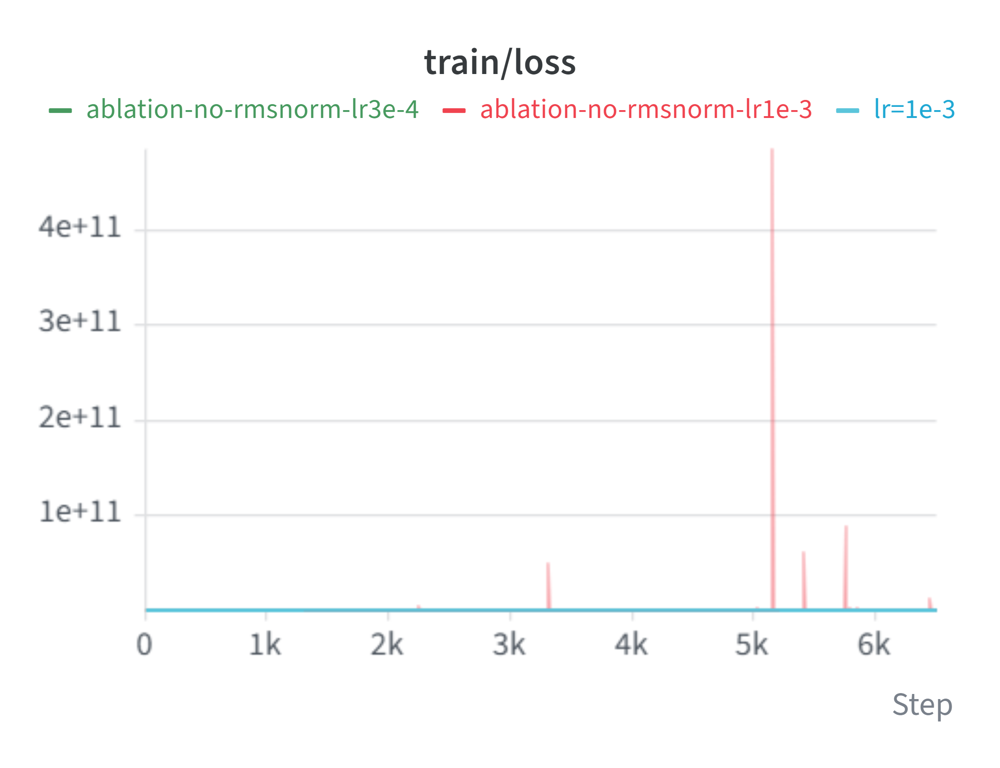
  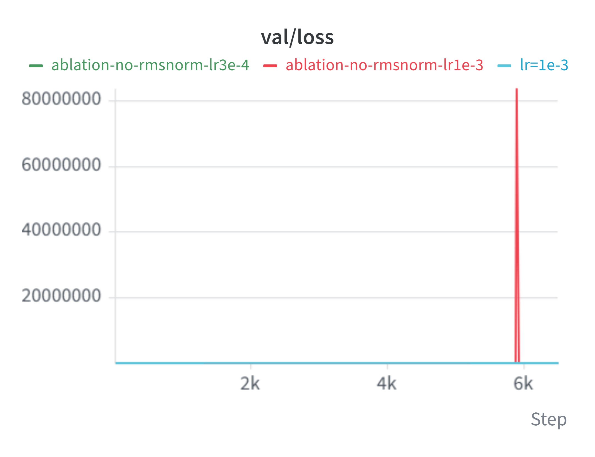
</p>

<p align="center">
  <em>Figure 3. Training loss（左）与 validation loss（右）的全尺度对比。No RMSNorm (lr=1e-3) 的极端 loss spike 显著拉伸了纵轴范围。</em>
</p>

<p align="center">
  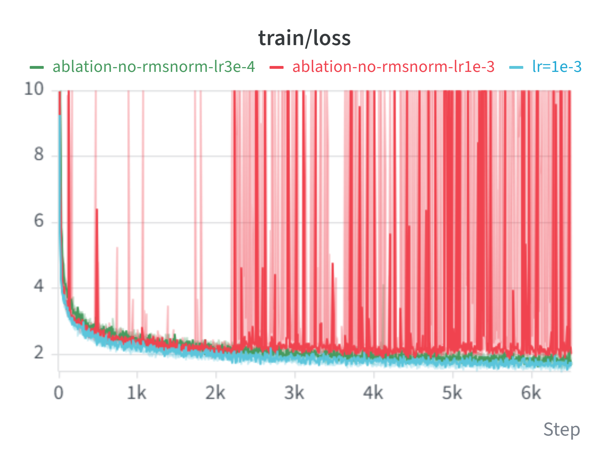
  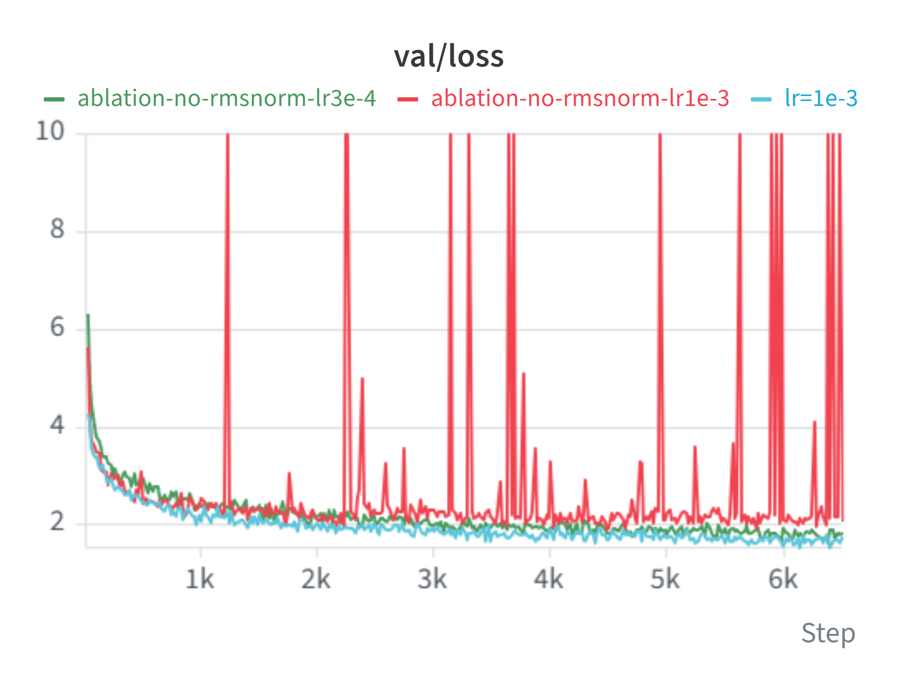
</p>

<p align="center">
  <em>Figure 4. 将 y-axis 限制在 0–10 后的 training loss（左）与 validation loss（右），用于观察正常 loss 区间内各配置的收敛与波动情况。</em>
</p>

### 移除 RMSNorm 时 Gradient Clipping 的作用 

为了进一步分析 Gradient Clipping 在移除 RMSNorm 后对训练稳定性的影响，固定 Learning Rate 为 `3e-4`，仅比较启用与关闭 Gradient Clipping 的两组实验。

在启用 Gradient Clipping 时，No RMSNorm 配置能够维持相对稳定的训练；关闭 Gradient Clipping 后，模型在前期仍表现正常，但在约 **4700 steps** 后出现明显失稳，并最终发生 catastrophic divergence。

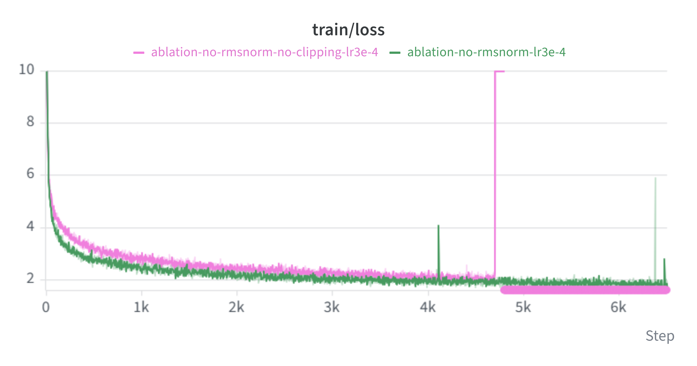

*Figure 5. No RMSNorm 条件下，`lr=3e-4` 时启用与关闭 Gradient Clipping 的 training loss 对比。图中 y-axis 采用截断范围以突出正常训练阶段及发散前后的变化。*

<p align="center">
  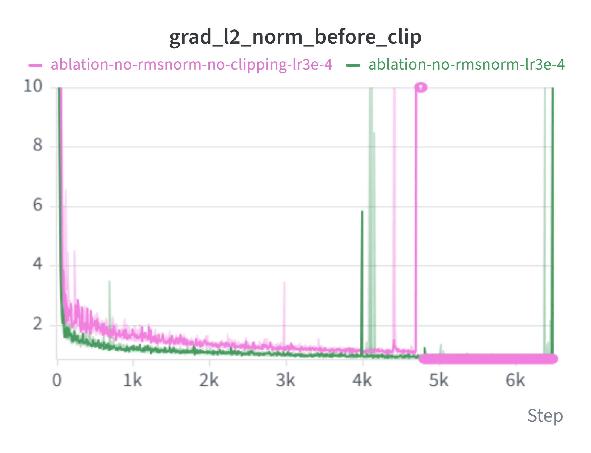
  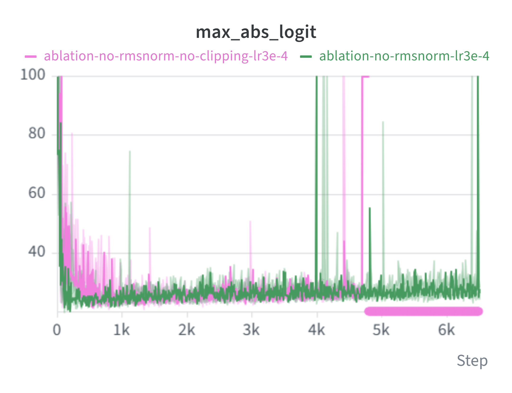
</p>

<p align="center">
  <em>Figure 6. No RMSNorm + No Clipping (`lr=3e-4`) 条件下的 Gradient Norm（左）与 logits magnitude（右）。两者在训练失稳阶段同步急剧增长；图中 y-axis 均采用截断范围以便观察发散前后的变化。</em>
</p>

在相同 lr=3e-4 下，启用 Gradient Clipping 的模型不仅能够稳定完成训练，其 training loss 在整个训练过程中也普遍低于 No Clipping 配置。关闭 Gradient Clipping 后，模型虽然在前约 4700 steps 内尚未发生数值发散，但收敛速度已经明显较慢，并伴随更频繁的 Gradient Norm 和 logits 异常波动。约 4700 steps 后，这些不稳定性最终演化为 catastrophic divergence，loss 快速增长并随后进入 NaN。

### 结果分析

实验表明，RMSNorm 对当前 Transformer 的训练稳定性具有明显作用。

在 Baseline 配置中，`lr=1e-3` 能够实现稳定训练；而移除 RMSNorm 后，相同 Learning Rate 下出现大量 loss spike，说明模型对参数更新和激活尺度的变化更加敏感。虽然这些 spike 并未立即导致训练完全失败，但模型整体优化过程明显更加不稳定。

降低 Learning Rate 至 `3e-4` 后，No RMSNorm 配置的稳定性明显改善，说明 RMSNorm 缺失造成的不稳定性可以部分通过更保守的优化步长缓解。这也表明 Normalization 与 Learning Rate 之间存在明显耦合：移除 Normalization 后，模型可稳定训练的 Learning Rate 范围明显缩小。

进一步关闭 Gradient Clipping 后可以看到，clipping 的作用并不仅体现在避免最终的 catastrophic divergence。即使在发生数值发散之前，No Clipping 配置的 training loss 下降速度也已经明显更慢，并伴随更多 Gradient Norm 与 logits 的异常波动。这说明在缺少 RMSNorm 的情况下，Gradient Clipping 从训练早期就开始限制破坏性的参数更新，使优化轨迹更加稳定。

约 4700 steps 后，No Clipping 配置中的 loss、Gradient Norm 和 logits 同步急剧增长，并最终进入 `NaN`。这一现象进一步说明，在模型 Normalization 稳定性降低后，Gradient Clipping 成为了防止偶发大梯度更新演化为不可逆数值发散的重要保护机制。

### 结论

RMSNorm 不仅影响模型的最终优化效果，更重要的是显著提升了训练稳定性以及对较大 Learning Rate 的容忍度。

本实验得到以下结论：

- 移除 RMSNorm 后，`lr=1e-3` 下出现频繁且显著的 loss spike，训练稳定性明显下降；
- 将 Learning Rate 降低至 `3e-4` 可以部分恢复稳定训练，说明 No RMSNorm 配置对优化超参数更加敏感；
- 在相同 `lr=3e-4` 下，启用 Gradient Clipping 的模型不仅避免了最终发散，也表现出更快、更稳定的 loss 下降；
- 关闭 Gradient Clipping 后，Gradient Norm 与 logits 的异常波动在 catastrophic divergence 之前就已经出现，最终在约 4700 steps 后演化为彻底发散；
- RMSNorm、Learning Rate 和 Gradient Clipping 并非独立影响训练稳定性，而是共同决定了模型可稳定优化的范围。

整体来看，RMSNorm 提供了更稳定的 activation / optimization environment，而 Gradient Clipping 则进一步限制异常大的参数更新，为训练提供额外的稳定性边界。

## 3. Pre-Norm vs Post-Norm

### 实验目的

Transformer Block 中 Normalization 的位置会影响 residual path 上的梯度传播和训练稳定性。本实验比较 Pre-Norm 与 Post-Norm 两种结构，观察 Normalization 位置变化对模型收敛速度、training / validation loss 以及训练稳定性的影响。

### 实验设置

Baseline 使用 Pre-Norm Transformer，即在 Self-Attention 和 FFN 子层之前进行 RMSNorm：

```text
x -> RMSNorm -> Attention -> Residual Add
x -> RMSNorm -> FFN       -> Residual Add
```

Post-Norm 版本则将 RMSNorm 移到 residual addition 之后：

```text
x -> Attention -> Residual Add -> RMSNorm
x -> FFN       -> Residual Add -> RMSNorm
```

除 Normalization 位置外，其余模型结构和训练配置保持一致。

| Configuration | Normalization |
|---|---|
| Baseline | Pre-Norm |
| Post-Norm | Post-Norm |

### 实验结果

<p align="center">
  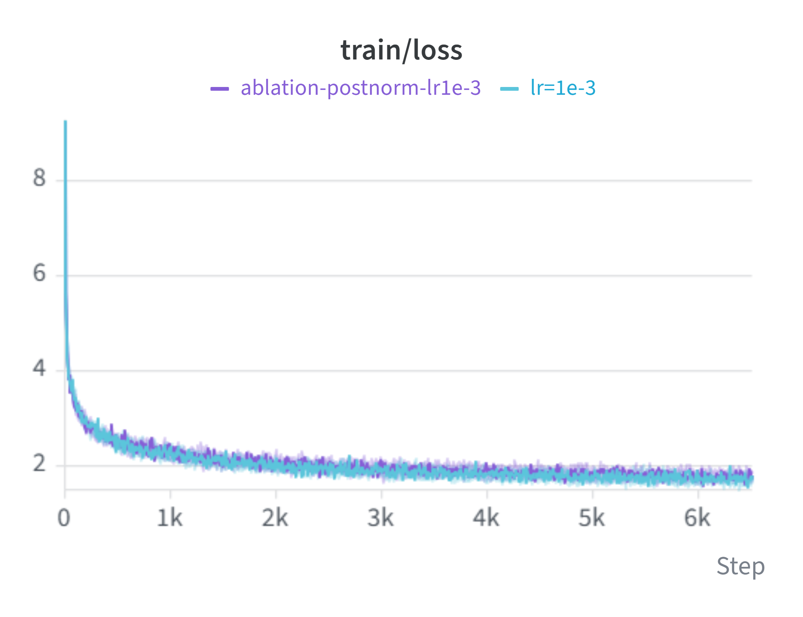
  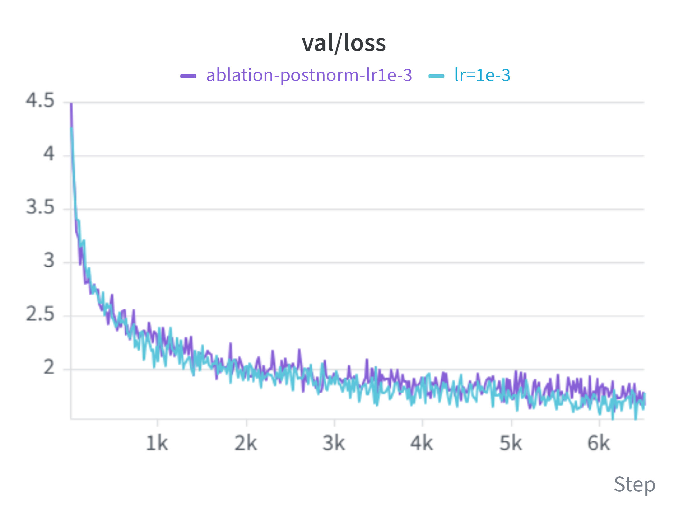
</p>

<p align="center">
  <em>Figure 7. lr=1e-3 时，Pre-Norm 和 Post-Norm 的 loss 曲线对比。</em>
</p>

| Architecture | `last_1000_mean` ↓ | `last_1000_std` ↓ | `last_500_mean` ↓ | `min_loss` ↓ | `step_to_1.8` ↓ | `step_to_2.0` ↓ |
|---|---:|---:|---:|---:|---:|---:|
| **Pre-Norm(Baseline)** | **1.69992** | **0.06668** | **1.69742** | **1.54023** | 2820 *(1.77718)* | 1400 *(1.95280)* |
| Post-Norm | 1.78932 | 0.08252 | 1.77118 | 1.61108 | 2820 *(1.79662)* | 1400 *(1.95099)* |

从整体训练过程来看，两种结构均能够完成训练，但 Post-Norm 的 loss 曲线波动更加明显，尤其在训练后期表现出更强的不稳定性。

相比之下，Pre-Norm 的 training loss 下降过程更平滑，validation loss 也表现出更稳定的收敛趋势。Post-Norm 虽然能够达到相近的 loss 区间，但后期波动较大，最终 validation 表现略逊于 Pre-Norm。

### 结果分析

从 early-stage convergence 来看，Pre-Norm 与 Post-Norm 的差异并不明显。两者首次达到 validation loss 2.0 和 1.8 的 step 完全一致，分别为 1400 和 2820。由于 validation 每 20 steps 进行一次评估，因此该指标本身具有一定离散性；同时，单次 validation loss 也会受到随机 batch 波动影响，因此相同的 threshold crossing step 并不意味着两种结构的整体收敛轨迹完全相同。

从完整 validation loss 曲线可以看到，两种结构在前期的下降速度基本处于同一水平，但随着训练进行，Post-Norm 的波动逐渐更加明显。相比之下，Pre-Norm 在后期表现出更平滑的收敛趋势。

这一差异也体现在后期统计指标上：Pre-Norm 的 `last_1000_mean` 为 **1.69992**，明显低于 Post-Norm 的 **1.78932**；同时 `last_1000_std` 由 0.08252 降至 **0.06668**。此外，Pre-Norm 的 `last_500_mean` 和 `min_loss` 也均优于 Post-Norm。

因此，本实验中两种结构的主要差异并不在 early convergence speed，而在于 **late-stage optimization stability 与最终收敛质量**。Pre-Norm 在当前训练配置下表现出更稳定、更充分的后期优化。

Pre-Norm 将 Normalization 放置在 Attention 和 FFN 之前，使 residual path 能够保持一条相对直接的梯度传播路径。相比之下，Post-Norm 在每次 residual addition 后再进行 Normalization，使梯度传播需要持续经过 Normalization 操作，在当前模型与训练配置下表现出更强的优化敏感性。

### 结论

在当前模型规模和训练配置下，Pre-Norm 相比 Post-Norm 表现出更好的训练稳定性：

- Pre-Norm 的 loss 曲线整体更加平滑；
- Post-Norm 在训练后期出现更明显的波动；
- Post-Norm 的最终 validation 表现略逊于 Pre-Norm；
- 两种结构都能够完成训练，但 Pre-Norm 对当前优化配置更加稳定。

## 4. RoPE Ablation

### 实验目的

RoPE（Rotary Positional Embedding）用于向 Attention 中注入相对位置信息，使模型能够区分不同 token 之间的顺序关系。本实验通过移除 RoPE，观察位置编码缺失对模型收敛速度、training / validation loss 以及最终性能的影响。

### 实验设置

Baseline 模型在 Multi-Head Self-Attention 中对 Query 和 Key 应用 RoPE；消融版本则完全移除 RoPE，其余模型结构和训练配置保持一致。

| Configuration | Positional Encoding |
|---|---|
| Baseline | RoPE |
| No RoPE | None |

### 实验结果

<p align="center">
  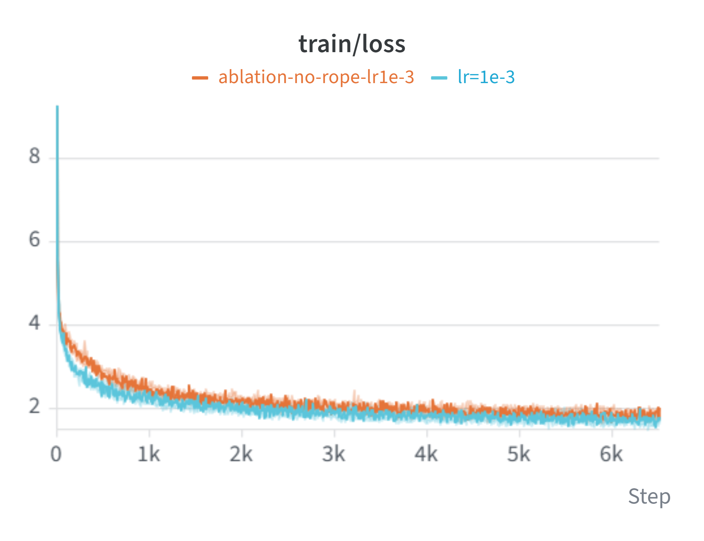
  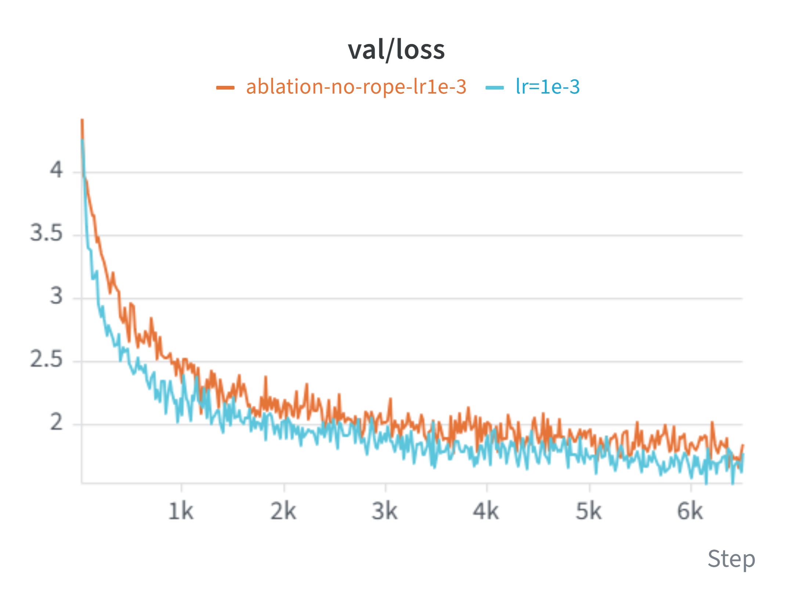
</p>

<p align="center">
  <em>Figure 8. lr=1e-3 时，RoPE 和 NoPE 的 loss 曲线对比。</em>
</p>

| Experiment | `last_1000_mean` ↓ | `last_1000_std` ↓ | `last_500_mean` ↓ | `min_loss` ↓ | `step_to_2.0` ↓ | `step_to_1.8` ↓ |
|---|---:|---:|---:|---:|---:|---:|
| **RoPE** | **1.699924** | **0.066685** | **1.697416** | **1.540232** | **1400** | **2820** |
| NoPE | 1.845865 | 0.076453 | 1.823082 | 1.663968 | 2400 | 3660 |

从训练过程可以观察到，移除 RoPE 后模型仍能够正常训练，但收敛速度明显降低，同时最终 training / validation loss 也高于 Baseline。

这说明在当前 autoregressive language modeling 任务中，缺少显式位置编码会显著削弱模型建模 token 顺序与相对位置关系的能力。

### 结果分析

RoPE 与 NoPE 的差异在本实验中较为明显，并且体现在收敛速度、最终 loss 和后期训练稳定性等多个方面。

首先，从 early-stage convergence 来看，使用 RoPE 的模型明显更快。RoPE 配置在 1400 steps 时首次达到 validation loss 2.0，而 NoPE 需要 2400 steps；达到 1.8 的时间分别为 2820 和 3660 steps。这说明显式位置编码显著提高了模型在固定 training budget 下的优化效率。

其次，RoPE 的最终收敛质量也明显更好。其 last_1000_mean 为 1.699924，相比 NoPE 的 1.845865 更低；last_500_mean 和 min_loss 也分别达到 1.697416 和 1.540232，均明显优于 NoPE。

此外，RoPE 的 last_1000_std 也更低，表明其后期训练过程更加稳定。

整体来看，RoPE 并非只改善某一个训练阶段，而是在 收敛速度、最终性能和后期稳定性 上均表现出一致优势。这说明在当前 autoregressive language modeling 任务中，显式的位置编码对于模型有效利用 token 顺序和相对位置信息至关重要。

RoPE 直接作用于 Attention 中的 Query 和 Key，使 attention score 能够感知 token 之间的相对位置。移除 RoPE 后，模型仍然可以依赖 token content 本身进行一定程度的语言建模，但 Attention 缺乏明确的位置信息，因此难以充分区分相同 token 在不同序列位置上的作用。

### 结论

本实验中，RoPE 在所有主要指标上均优于 NoPE：

- 更快达到 validation loss 2.0 和 1.8；
- 更低的后期平均 loss；
- 更低的 minimum loss；
- 更小的后期 loss 波动。

因此，RoPE 对当前 Transformer 的训练效率和最终建模能力具有显著贡献。移除位置编码后，模型虽然仍能完成训练，但优化速度和最终性能均明显下降。

## 5. SwiGLU vs SiLU

### 实验目的

### 实验设置

### 实验结果

### 结论

## Summary

| Experiment | Variant | Main Finding |
|---|---|---|
| Learning Rate | 多组 LR 对比 | 待整理 |
| RMSNorm | Remove RMSNorm | 待整理 |
| Gradient Clipping | Disable Clipping | 待整理 |
| Normalization | Pre-Norm vs Post-Norm | 待整理 |
| Positional Encoding | Remove RoPE | 待整理 |
| FFN | SwiGLU vs SiLU | 待整理 |